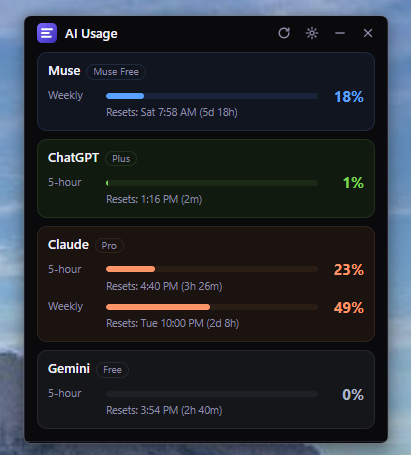
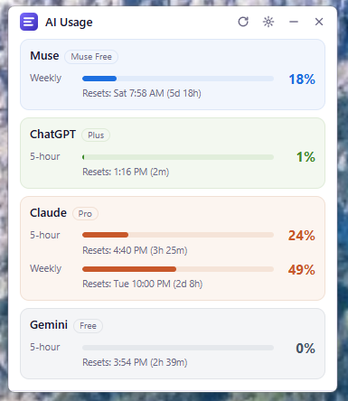
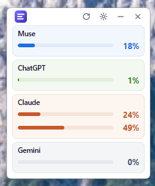
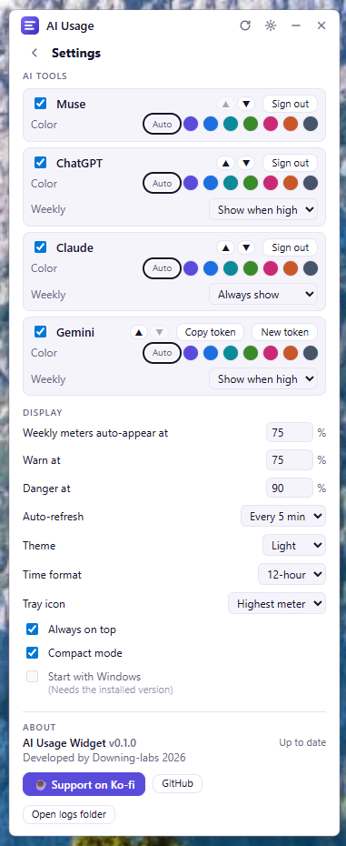
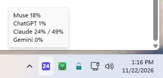
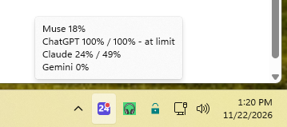

# AI Usage Widget

One small always-available widget that shows how much of your AI usage limits you have left, across the tools you actually use.

| Tool | Meters | How it is read |
| --- | --- | --- |
| Claude | 5-hour, weekly | Your signed-in claude.ai session |
| ChatGPT | 5-hour, weekly | Your signed-in chatgpt.com session |
| Muse | Weekly | Your signed-in muse.ai session |
| Gemini | 5-hour, weekly | A small Chrome companion extension (opt-in) |

Windows first. macOS support is planned.

> Status: early development (v0.1.0).

<p align="center">
  
</p>

## Features

- **Pick your tools.** Tick the ones you use, sign in, done. Unticked tools are never polled.
- **Meters per tool.** The 5-hour meter is always shown. Weekly meters can be "Always show" or "Show when high" (appears once it passes your threshold).
- **Tray icon.** Shows the highest meter by default, or pin it to one tool. A red dot appears when another tool is running low. The tooltip lists every tool's status.
- **Per-tool colors.** Each card has its own color, with sensible "Auto" defaults.
- **Compact mode.** One slim line per meter. Settings always opens at full size.
- **Light, dark or system theme**, 12/24-hour time, always-on-top, start with Windows (installed builds), configurable warn and danger levels, and a configurable auto-refresh.
- **Reorder tools** with the arrows in Settings.

### How the tray decides what to show

- The tray number follows the **5-hour (daily) meters**. A weekly meter only takes over once it reaches the **"Weekly meters auto-appear at"** level (default 75%). That same setting controls when "Show when high" weekly cards appear.
- Meters that are used up (99%+) are skipped so the icon moves on to a meter that still has room.
- If you pin a tool, the icon stays on it. A red dot warns you when any other tool's meter is at the danger level (default 90%), or when some of your meters are used up and others are not.

## Screenshots

| Light theme | Compact mode | Settings |
| --- | --- | --- |
|  |  |  |

The tray icon shows the highest meter. Hover for every tool's status:



When one tool is used up, the icon skips it, shows the next-highest meter and adds a red dot:



## Download (Windows)

Two builds are produced for each release:

| Build | File | Notes |
| --- | --- | --- |
| Installer | `AI.Usage.Widget-<version>-win-Setup.exe` | Installs per user. Start Menu and desktop shortcuts. Supports **Start with Windows**. |
| Portable | `AI.Usage.Widget-<version>-win-portable.exe` | Single file, no install. Run it from any folder. No **Start with Windows**. |

The builds are not code-signed yet, so Windows SmartScreen may warn on first run. Choose "More info", then "Run anyway".

The Gemini Chrome extension is a separate folder (`extensions/gemini`). The installer puts a copy next to the app, in its `resources\extensions\gemini` folder. With the portable build, get the folder from this repository.

## Run from source

Requirements: Node.js 22.12 or newer (required by Electron 41) and npm.

```
git clone https://github.com/downing-labs/ai-usage-widget.git
cd ai-usage-widget
npm install
npm start
```

Debug mode adds an "Open logs folder" button and extra tray items for testing:

```
npm run start:debug
```

Run the tests:

```
npm test
```

Build the Windows installer and portable (output goes to `dist/`):

```
npm run build:win
```

If `NODE_ENV=production` is set on your machine, npm skips dev dependencies. Clear it for the install and build (`$env:NODE_ENV=''` in PowerShell).

## Signing in

For Claude, ChatGPT and Muse, click **Sign in** on the tool's card. A normal sign-in window for that service opens. You sign in on the service's own page, and the widget then reads your usage from that signed-in session. The widget does not ask for, see or store your password. **Sign out** clears the session.

## Gemini (Chrome companion)

Google blocks sign-in inside embedded browsers, so Gemini works through a small Chrome extension that reads your Gemini usage page in your own Chrome and reports it to the widget. It is opt-in: nothing is polled or listened for until you enable Gemini in Settings.

1. In the widget, enable Gemini and click **Copy token**.
2. In Chrome, open `chrome://extensions`, turn on Developer mode, click **Load unpacked** and choose the `extensions/gemini` folder.
3. Open the extension's options, paste the token and click Save. It will tell you if it can reach the widget.
4. Stay signed in to Gemini in Chrome.

How it is locked down:

- The bridge listens on `127.0.0.1` only, and only while Gemini is enabled.
- Requests must come from a Chrome extension (not a web page), must use a loopback host, and must carry the shared token. **New token** in Settings rotates it.
- Only the usage percentages and reset times are sent.

The extension is installed by hand on purpose, so it does not sync to every Chrome you are signed into.

## Privacy and security

- Everything runs locally. There is no server, account or telemetry.
- Usage is read with your own signed-in sessions, from the same pages and endpoints those sites use themselves. Those endpoints are not official, public APIs and may change without notice. If a meter stops working after a site update, please open an issue.
- Settings and sessions are stored on your machine only.
- The only network call the widget makes of its own is an update check against this repository's GitHub releases.

## Project layout

```
main.js              Electron main process: window, tray, IPC
preload.js           Safe bridge between the UI and main
src/providers/       One module per tool (parsing and plan labels)
src/session.js       Hidden-window session for Claude, ChatGPT, Muse
src/session-external.js, src/bridge.js   Gemini companion path
src/settings.js      Settings model and validation
src/visibility.js    Which cards and meters to show
src/tray-text.js     Tray icon and tooltip logic
src/renderer/        The widget UI
extensions/gemini/   Chrome companion extension
test/                Unit tests (node --test)
```

## Known limitations

- Windows only for now. The macOS tray title is written but untested.
- Gemini paid-plan names are not verified yet, so paid plans show no plan label.
- Plan labels for some Claude and ChatGPT tiers are unverified.

## License

GPL-3.0-only. See `LICENSE`.

Developed by Downing-labs. If you find it useful, you can support the project on Ko-fi from the link in the app.
